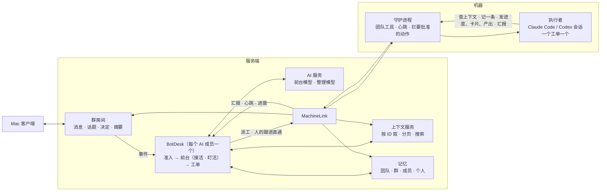
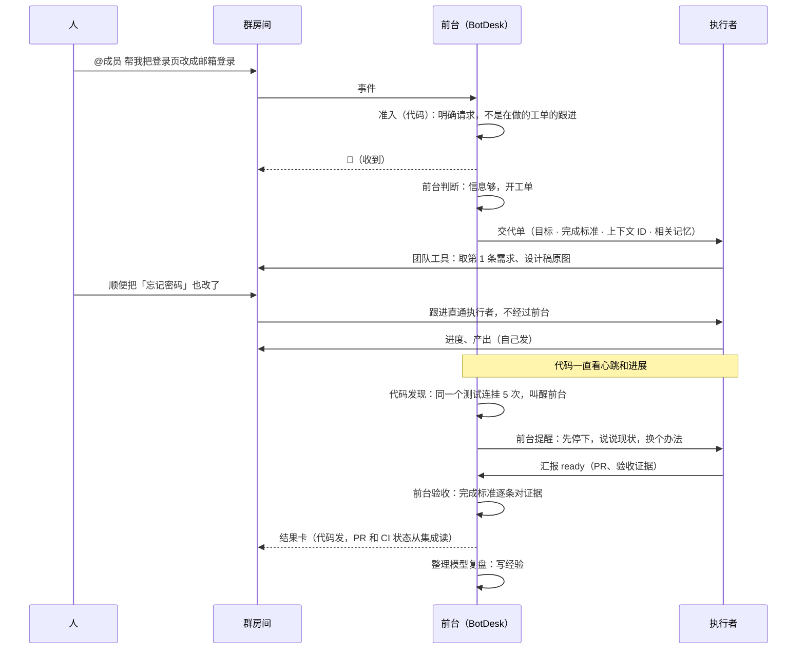

# AI 成员的 harness：前台 + 执行者、盯活、工作线、上下文、批准、沉淀

状态：已拍板并实现（M1–M6 在 2026-11-08 合并），之后按「可用版」修和补；下面的正文是当时的方案，和实现不一样的地方以
「实现状态」一节为准。日期 2026-11-08，实现状态更新于 2026-11-12。取代只讲选模型的草案。

## 实现状态

还没做完、还没在真电脑上验过的，逐条在 [docs/plans/usable.zh.md](../plans/usable.zh.md) 和
[docs/plans/usable/](../plans/usable/) 下（接、盯、机、模四份审计，真机验证记录 verify-log.zh.md）。这一节只说主线上已经
有什么、和下面的方案哪里不同。

**做了的**

- 前台（3.2）：服务端 `server/src/agent/frontdesk.ts`、`server/src/bots/desk/front.ts`。先存后做，判断记录在开发者视图。
  没配 AI 服务时走规则路径（每个请求都派给执行者）。
- 上下文（第 5 节）：`server/src/context/`，按 ID 取、分页、搜索；请求自带的附件、引用、产出进提示词。
- 工作线（第 4 节）：同一成员、同一话题、同一仓库共用一个工作目录、一个分支和一个 CLI 会话；私聊默认续上一个会话。
- 盯活（3.4）：`server/src/agent/supervise.ts`、`server/src/bots/desk/stall.ts`。催一次、提醒打转、同会话重来、最后换电脑；
  电脑失联先等；到时限先存档再续一轮；重来带恢复说明，对外动过的不自动重跑；盯活做的每一步记在运行上。
- 结构化汇报：`chat-run report --state done|blocked|waiting`，话题状态按汇报算；结果卡的数字从运行记录取；失败按类别说一句中文。
- 要批准的动作（第 6 节）：守护进程在执行那一步拦（Claude Code 的 hook、Codex 和 ACP 的权限请求、任务 PATH 最前面的垫片），
  卡片直接发给批准人，「这件事里都同意」；问不到守护进程时一律拒绝。
- 转交和分出去（3.5）：`chat-run handoff`、`chat-run assign`，有层数、次数和回环上限，「全部停止」。另加了人写的顺序
  `@A → @B → @C`（界面叫「按顺序做」），设计见 [design-relay.zh.md](../plans/usable/design-relay.zh.md)。
- 沉淀（第 7 节）：`server/src/memory/`，四层、版本、全文检索（`chat-run memory search`）、运行后复盘、按团队时区每天整理、
  记忆更新和撤回；按群过滤，私聊来的只对当事人可见。
- 评估（第 9 节）：前台判断的回放集（`server/scripts/replay-frontdesk.ts`）和提示词补丁登记（`server/src/agent/patches.ts`）。
- 模型（第 8 节）：电脑上报模型和思考强度；团队按运行方式设一次，运行记录写实际用的模型和思考强度。

**和方案不同的**

- **团队工具走命令行，不走 MCP**（3.3、第 10 节、第 11 节）：守护进程把 `chat-run` 放在任务的 PATH 上，读话题、产出、
  卡片、决定、成员名单、记忆，发卡片、产出、汇报，转交和分出去都是它的子命令，经守护进程（本地 socket，Codex 用请求目录）
  到服务端，见 [machine-protocol.md](../machine-protocol.md) 的 `output` 和 `context` 特性。usable.zh.md 第 4 节定了保留
  命令行、不做 MCP。
- **前台只有四种决定**（3.2）：回复（`reply`）、派工（`dispatch`，带交代单）、追问一句（`ask`，发成卡片）、不理
  （`skip`）。表里的 `attach`、`steer`、`handoff`、`note`、`stop` 不由前台做：跟进由代码直通在做的运行；转交由执行者自己做；
  「停」在没配 AI 服务时由代码认出来，停下请求人自己的运行；配了时前台不处理，「停」作为补充交给在做的运行（要停就点 **停止**）。前台没有读工具，读的是代码先备好的话题。
- **盯活不调模型**（3.4）：「出了事才叫醒模型」那一层没有做，九种处理里只做了代码能做的（提醒、打断重来、换电脑、告诉人、
  停止）。没有备用模型、换档、拆小。
- **没有工单对象**（第 4 节）：`WorkOrder`、`work.updated` 没有加；一件事由运行、话题的参与成员和 `chainId` 串起来。
  一个话题可以有几个 AI 成员一起或先后在做，`ownerId` 只决定不带 @ 的跟进给谁。
- **没有档位**（第 8 节）：「更快」「更强」、@ 胶囊上选档、成员档位（先问、只在工作目录）都不做。
- **等批准时整件事停住**（第 6 节）：hook 同步等待，「不卡住整件事」这一条不做。没有代审。
- **接管**做成状态机：每个运行一个人看得见的状态（`BotRun.phase`），暂停、继续、接管、交还，接管时在应用里对工作目录跑命令
  （已合并：服务端为每个运行算出 `phase`，有 `holdKind`、交还小结 `lastHandback`，路由 `/v1/runs/:id/pause`、`/resume`、
  `/takeover`、`/commands`；应用的状态和界面；守护进程的 `takeover` 特性，虚拟机里只停 CLI 不再整台暂停）。设计见
  [design-takeover.zh.md](../plans/usable/design-takeover.zh.md)。
- **单独问**还是只读的单独运行，不是从执行者的会话分叉；跨电脑还原会话没有做，换电脑时开新会话并带恢复说明。

第 13 节已定，见那一节开头。

## 0. 结论

AI 成员现在的做法是：每次被 @，就把话题最近 30 行聊天记录拼成一段提示词，整包交给机器上的 Claude Code 或
Codex。服务端不思考，做完什么都没留下。

改成四件事：

1. **前台 + 执行者**：每个 AI 成员在服务端有一个常驻的**前台**。它用便宜、快的模型，不碰电脑，像经理：接活、派活，还要
   盯活。它不在执行者每一步的路上：执行者查上下文、发进度、发卡片问人、交结果都直接做。但心跳、进展、打转、超时由代码
   一直看着，出了事才叫醒前台模型。前台先自己处理（提醒、打断重来、换电脑、换档、拆小、转交），处理不了再告诉人。机器上
   的**执行者**用强模型，一件事一个会话，拿一张交代单做到底。
2. **工作线和上下文**：一件事一个工单、一个会话，群聊里不相干的事不再挤进同一个会话，换电脑或崩溃后能接着做。上下文
   当缓存：只放摘要和 ID，需要时按 ID 去查；话题开头那条、图片、卡片、引用都不再丢。
3. **少数动作要批准**：默认全开。只有团队勾选的几类不可撤回、或者对外的动作要人批准：合并到 main、上生产、改生产配置、
   删数据、对外发布。守护进程在执行那一步时拦下，卡片直接发给批准人，不经过前台；同一件事里可以一次同意。
4. **沉淀**：团队、群、成员、个人四层记忆。白天顺手记，每天夜里整理一次（类似 Claude 的 dreaming：对照原文核对、合并、去掉过时的），整理完直接
   生效，不发确认卡。界面上每天有一份「记忆更新」，
   每行都能撤回。人明确说的约定马上生效。

原设计文档其实就是这么定的：第 5 条决定"bot 分成前台和执行者"，还有"上下文当缓存"
（[design-doc.zh.md:69](design-doc.zh.md)、[:424](design-doc.zh.md)）。但实现时只做了执行者，前台被做成了"没有模型的
固定规则"。这份方案把缺的那一半补上，并加上原文档没写的工作线和沉淀。



## 1. 现状

现在是三段：Mac 客户端，服务端（Cloudflare：群房间、成员连接、BotDesk、MachineLink），以及机器上的守护进程。真正动手的
是守护进程起的 CLI。服务端只在给话题起标题时调一次模型（[protocol.md:1585](../protocol.md)），其余时候既不思考，也不动手。

### 1.1 没有 router

BotDesk 的注释原话是 "It never runs commands and has no model: fixed rules turn a mention into a run on a machine"
（[external.ts:1](../../server/src/bots/desk/external.ts)）。所以一句"进度怎样"也要排队等一台电脑、启动一个 CLI。人的
请求没有人追问、没有人拆分，也没有人记住任务之间的关系。

### 1.2 为什么只看得到几条消息

代码里写死的是 30 行，没有写死 3 条，但实际看得到的人话可能只剩几条：

| 原因 | 位置 |
| --- | --- |
| 窗口按行数算，不按长度：取话题最近 30 行 | [dispatch.ts:25](../../server/src/bots/dispatch.ts)、[room.ts:107](../../server/src/bots/room.ts) |
| 只取正文。没有正文的行（图片、文件）直接丢掉；卡片里的回答和引用的原文不在里面 | [runs.ts:193](../../server/src/bots/desk/runs.ts) |
| 群聊是一条时间线，所有人、所有事共用这 30 行 | 同上 |
| 话题超过 30 行后，开头那条需求被挤掉 | 同上 |
| 成员没有往回翻的工具：`chat-run` 只能发卡片和产出，看不到的就永远看不到 | [chat_run.rs:66](../../apps/daemon/src/chat_run.rs) |
| 外部接入的成员只收到触发它的那一条 | [bot.ts:165](../../packages/bot-sdk/src/bot.ts) |
| 单独问只拿源话题最近 60 行，看不到执行者实际做了什么 | [room.ts:87](../../server/src/bots/room.ts) |

不管窗口设 3 行还是 30 行，固定窗口这个做法本身就错了。

### 1.3 没有工作线（threads）

- 会话按"同一话题 + 同一台电脑 + 同一运行方式"续接（[runs.ts:172](../../server/src/bots/desk/runs.ts)）。群聊里同一个
  成员的所有请求会挤进同一个 CLI 会话，不相干的事互相污染。
- 换一台电脑就续不上，因为会话文件在原来那台电脑上。
- 续接时还会把 30 行整包重发：提示词在选电脑之前就拼好了，不知道这次会续接（[runs.ts:82](../../server/src/bots/desk/runs.ts)、
  [:267](../../server/src/bots/desk/runs.ts)）。
- 没有"一件事"这个对象。现在的运行（run）只是一次尝试，没有目标、范围、完成标准，也没有交接。

### 1.4 没有沉淀

- 身份只有一句 `You are {name}, a member of a team chat`（[dispatch.ts:226](../../server/src/bots/dispatch.ts)）。岗位和职责不进
  提示词，也没有成员自己的工作说明。
- 群里的决定已经存了，但不进上下文。
- 每件事做完什么都没留下：同一个错下次照犯，同一个偏好每次都要重讲。原设计文档写了"换模型或换 CLI 以后，身份、记忆和
  历史都不丢"（[design-doc.zh.md:36](design-doc.zh.md)）、"智能可以租，上下文只能自己积累"（[:82](design-doc.zh.md)），
  都没有落地。

### 1.5 卡住了没人管

- 运行 10 分钟没有新事件，就标成"卡住"（[dispatch.ts:9](../../server/src/bots/dispatch.ts)、
  [stall.ts](../../server/src/bots/desk/stall.ts)），然后就没有下文了：没人去看卡在哪，不重来、不换电脑，也不告诉人试过
  什么。
- 只看"有没有新事件"：一直在打转的运行（同一条命令反复跑、同一个错反复出）永远不算卡住。
- 没有时限：一件小事跑三个小时也没人问。电脑掉线时，也只能等它自己回来。

### 1.6 选不了模型

协议、数据库和守护进程都有 `model` 字段，但设置界面不显示也不能改。电脑不上报能用哪些模型，也没有思考强度可调。

## 2. 这里说的 harness 是什么

- harness 是让人和 AI 成员持续协作的机制：把人的意图、上下文和团队约定接到成员的动作上，再把结果送回人的工作流。
- 力气只花在模型学不会的地方：
  - 状态和续跑，崩溃后不重复对外动作；
  - 交接，以及人随时插手的点：补一句、改方向、停下；
  - 真实结果，例如 CI 状态由程序读，不听模型报；
  - 私有上下文：团队的决定，"照常"对这个团队是什么意思；
  - 成本看得见。
- 执行者默认全开。只有少数不可撤回、或者对外的动作要人批准（第 6 节），批准卡直接发给批准人，其他动作不拦。
- 派出去不等于不管：前台像经理，盯着手下每一个执行者。卡住了它先自己处理，不让一件事无声无息地停在那里。
- 教模型做事的提示词补丁（跑测试、写 todo）活不过一两代模型。每条补丁都带一个失败用例，换代就测，裸模型能过就删。
- 这个产品处在"组织"这一层：跨角色的人，加上他们的 AI 成员。这一层最难被模型吸收，也是产品的价值所在。
- 少占人的注意力：只在人必须动手或结果能用时出声。

## 3. 前台 + 执行者

| 层 | 在哪 | 模型 | 做什么 | 不做什么 |
| --- | --- | --- | --- | --- |
| 准入（gate） | BotDesk 代码 | 不用 | 判定是谁在找谁、算不算请求、是不是在做的工单的跟进（是就直通执行者） | 不调模型 |
| 前台（router + manager） | BotDesk | 团队 AI 服务的"前台模型"，便宜、快 | 接活：直接答、追问、开工单派工、挂到在做的工单、停止、转交、记下来。盯活：执行者卡住、打转、超时、交结果时被叫醒，决定怎么处理（3.4） | 没有 shell，不碰仓库和电脑；不在执行者每一步的路上 |
| 执行者（worker） | 机器上的 CLI 会话 | 成员配的强模型 | 按交代单做到底：按需查上下文，在话题里直接发进度、卡片和产出，结构化汇报 | 不自己决定接不接活 |
| 服务端动作 | 服务端代码 | 不用 | 能走 API 的走 API：CI、PR 状态、定时提醒、卡片上的实时数据 | |

前台放在服务端，不放机器上：它要一直在线，不能依赖某台电脑，也要和群房间放在一起。每个 AI 成员一个前台：同一套引擎，各自的
身份和记忆。没有指名的交代（⌘↵ 交给主助手）由主助手的前台接，它可以再转交给别的成员。

前台不在执行者每一步的路上：执行者查上下文、发消息和卡片、交产出都直接做，不经过前台模型。但前台对手下每个在做的工单
负责到底，像经理：平时不打扰，出了事才被叫醒（3.4）。



### 3.1 准入（代码）

- **到达成员的事件**：被 @、私聊、自己负责的话题里有新消息、自己发的卡片收到回答或操作、别的成员转交、执行者汇报、订阅
  话题里的集成事件、定时器。
- **人的 @ 或私聊**：算明确请求。
- **谁来接，先用规则定，定不了才问模型**（参照 OpenBot 的频道路由）。按顺序取第一个命中的：
  1. 指名：@ 了谁，或者私聊；
  2. 回复的是某个工单里的消息，就交给那个工单；
  3. 话题里只有一个在做的工单，而且明显是接着说的，就交给它；
  4. 群里只有一个 AI 成员；
  5. "继续""接着做"这类话，恢复停下的工单。

  都不命中，才让主助手的前台判断该谁接。前台必须按固定格式答：交给谁、接着哪个工单、追问一句，或者不接。格式不对就算没判断
  出来，在话题里给人一个选择。前台判断期间话题有了变化，这次判断作废重来。前台没把握（自评低于 0.6）时，交给群里设的默认
  成员，不乱派（参照 OpenMausBot）。
- **有工单的话题里人的跟进**：直通执行者，不经过前台。现在已经这样做，见 `run.input`。执行者认为跟进说的是另一件事时，可以退回一次，
  退回后交给前台。据 DeepSeek 文章的消融实验（二手转述），没有直通时前台要多做约 30% 的判断，多用约 37% 的 token。
- **机器人和集成的消息**：只作为上下文送进订阅了那个话题的工单，永远不开新活（保留"机器人消息不启动运行"这条规则）。
  主动接活（例如 CI 挂了自动修）只按人在设置里开的规则来，开了就直接做。
- **串行和合批**：同一话题的前台判断一次只跑一个；判断期间进来的新消息合进下一批。DeepSeek 自报每次判断从 6.4 s 降到
  1.6 s。
- **人优先**：执行者名额满了，也给人的消息留一个名额。

### 3.2 前台

> 实现：前台只有 `reply`、`dispatch`、`ask`、`skip` 四种决定，没有读工具，见文首「实现状态」。

每一轮先读第 5.2 节列的上下文，再从下面这组固定的决定里选，可以一次选几个：

| 决定 | 用在 | 结果 |
| --- | --- | --- |
| `answer` | 问答、查进度、总结、找东西 | 前台直接回复（流式），不派工 |
| `ask` | 完全没法开始 | 发一张 Card v2，一次只问一个具体问题。能合理假设就不问：直接派工，把假设写进回复和交代单 |
| `dispatch` | 要干活 | 开工单，派给执行者 |
| `attach` | 消息明确指向一个已有工单 | 挂过去，作为它的输入 |
| `steer` | 给在做的工单补一句 | `run.input` |
| `stop` | 人要求停 | 停止工单 |
| `handoff` | 该别的成员做 | 转交（3.5） |
| `note` | 值得记下来 | 写进记忆（第 7 节） |
| `ignore` | 谢谢、闲聊 | 不出声 |

前台的工具都在服务端：

- **读**：`topic_read`、`message_get`、`search`、`artifact_get`、`decisions_list`、`memory_search`、`work_list`、`run_status`、
  `github_status`（走集成）、`machines`。
- **写**：上表的决定，再加 `reply`、`card_post`、`desk_note`、`timer_set`。

运行规则：

- **限额**：每轮最多 6 步工具调用，30 s，token 有上限。超时重排两次，第三次记为"没判断出来"，在开发者视图显示，并改走
  降级路径。
- **降级**：没配 AI 服务时走今天的规则路径，只是提示词换成第 5.3 节的交代单。
- **缓存**：固定前缀（身份、团队约定、工具定义）放最前面并保持稳定，命中供应商的提示词缓存。
- **派活留痕**：前台用模型决定派给谁时，话题里留一行"已交给 {成员}"；按规则派的不留（参照 OpenBot）。
- **问几个人**：同一个请求派给几个成员时，每人各开一个工单。在写完自己的之前，看不到别人的回答，各说各的看法（参照 OpenBot）。
- **留痕**：每个决定都存下理由，开发者视图里能看到"为什么这样处理"。

### 3.3 执行者

- 一个工单对应一个执行会话（Codex thread 或 Claude Code session），会话里可以有多次运行。重试是在同一会话里再派一次；
  新工单就开新会话。
- 执行者拿到的是交代单，不是聊天记录：
  - 目标和完成标准；
  - 上下文摘要和 ID 清单；
  - 相关记忆；
  - 仓库和分支；
  - 怎么汇报。

  这些之外，还有一段稳定的"在这里怎么工作"说明，走 Claude Code `--append-system-prompt` 或 Codex developerInstructions，
  这个通道现在已经有了。
- （实现：团队工具是 `chat-run` 命令，不是 MCP，见文首「实现状态」。）团队工具由守护进程给每次运行起一个 MCP 服务
  （Claude Code `--mcp-config`；Codex `mcp_servers` 或 app-server 的动态工具 `item/tool/call`；ACP `session/new.mcpServers`）。工具调用通过现有的 `output` 通道直接到服务端取数据，不经过前台模型：
  - `context_get(id)`、`topic_history(topic, before, limit)`、`search(q)`；
  - `file_get(id)`：把原图或原文件取到工作目录，Claude Code 能直接看图；
  - `memory_search(q)`、`memory_note(text)`；
  - `report(state, text)`、`handback(input, reason)`；
  - `assign(member, brief)`、`handoff(member, brief)`：分一部分出去，或者整件转交，不用回前台（3.5）。

  `chat-run` 现有的卡片、产出、文件操作都保留。要问人时，执行者自己发卡片问，回答直接回到它的会话（`run.answer`，
  现在已经是这样）。只在真没法往下做时才问；能合理假设就按假设做，在结果里写明。
- 汇报是结构化的：`progress`、`waiting`、`ready`、`blocked`、`failed`、`dropped`。话题状态和"在等谁"按汇报算，不从自由
  文本里猜。汇报先由代码处理；只有 `ready`、`blocked`、`failed` 和卡住信号会叫醒前台（3.4）。
- 结果卡照旧在运行结束时由 BotDesk 的代码发（现有的 Card v2 done 卡，[events.ts:444](../../server/src/bots/desk/events.ts)）：
  PR、CI 和验收证据从集成和运行记录里读，不信模型自己报。执行者自己做的交互卡片和产出照旧由它直接发。

### 3.4 盯活

> 实现：盯活只用代码规则，不叫醒模型；没有备用模型、换档和拆小，见文首「实现状态」。

前台是经理：不替执行者干活，也不在它每一步的路上，但要对手下每个在做的工单负责到底。分两层：代码一直看，出了事才叫醒
模型。

**代码一直看**（BotDesk 的闹钟加守护进程的心跳，不调模型）：

| 信号 | 怎么判 |
| --- | --- |
| 死了 | 守护进程每 30 s 报一次心跳，说 CLI 进程还在不在；连续 3 次没有，或者电脑掉线 |
| 静了 | 进程还在，但 N 分钟没有任何事件。N 按档位定：更快 5 分钟，更强 15 分钟；长命令在后台跑时不算 |
| 打转 | 同一条命令加同样的参数连跑 ≥ 4 次；同一个报错连续出现 ≥ 3 次；连续几条消息之间没有任何工具结果；连续两轮没有一次成功的工具调用 |
| 没进展 | 一直在动，但 30 分钟里没有新提交、没有文件变化，也没有汇报 |
| 超时 | 超过派工时前台估的时长的 2 倍 |
| 等人太久 | 执行者问了人，过了很久没人答 |
| 只说不做 | 一轮结束时计划里还有没做的步骤，或者只说了"我来看看"，却没调用任何工具 |
| 额度或供应商出错 | 用量到顶、限流、供应商报错、认证失败 |
| 交结果 | 汇报 `ready`、`blocked` 或 `failed` |

**代码能直接处理的，不叫醒模型**：

- **只说不做**：直接让执行者接着做，最多 3 次；没有新进展就停下，再叫醒前台（参照 OpenBot 的计划续跑、DS Bot 的"只说在做就推它继续"）。
- **额度或供应商出错**：这一轮还什么都没做，就换成员配的下一个备用模型重来，出错的模型 10 分钟内不再用；额度用完的模型挂起，
  到恢复时间再用（参照 OpenBot）。已经做过事的不自动换，叫醒前台。
- **CLI 进程崩了**：退避重启，最多 3 次，还不行才算"死了"（参照 OpenBot）。
- **重启后被打断的一轮**：没对外动过（推送、发消息、付钱）的重跑一次；动过的不重跑，带恢复说明，让执行者先核对做到了哪
  （参照 OpenMausBot、OpenBot：拿不准的副作用永远不重做）。

**出了事才叫醒模型**：任何一个信号触发，前台被叫醒一次。它读交代单、最近的汇报、最近 20 次工具调用的摘要和改动统计，
然后从下面选：

| 处理 | 什么时候 | 怎么做 |
| --- | --- | --- |
| 提醒 | 打转、静了 | 给执行者补一句（`run.input`）：说清看到了什么，让它先说现状、换个办法 |
| 打断重来 | 提醒没用 | 打断这一轮，在同一个会话里带一段恢复说明重来 |
| 换电脑 | 死了 | 在别的电脑上还原会话（第 4 节）；做不到就带交代单和进展摘要开新会话 |
| 换档 | 同一个错反复出现，能力不够 | 用更强的档开新会话，带上已经做的和踩过的坑 |
| 拆小 | 太大、超时 | 拆成几个工单，原工单等它们 |
| 转交 | 该别的成员做 | 3.5 |
| 催人 | 等人太久 | 提醒一次被问的人，不重复 |
| 告诉人 | 自己处理过两次还不行，或者确实缺只有人才知道的信息 | 在话题里发一条：卡在哪、试过什么、需要谁做什么。一件事只发一次，之后有变化才再说 |
| 停止 | 没救了，或者人说过停 | 停止工单，说明原因 |

规则：

- **有上限**：每个工单最多自动处理 3 次，之后只能告诉人或停止，防止前台和执行者互相打转。
- **验收**：执行者汇报 `ready` 时，前台先对一遍完成标准：PR 和 CI 由代码查，每条标准有没有证据由模型看。缺了就退回一次
  （例如"第 2 条没有证据"）；再缺，就照实发结果卡并标出来。
- **问进度不打扰执行者**：人问"进度怎样"，前台用它盯着的数据直接答，不去叫醒执行者。
- **看全局**：前台知道手下所有工单的状态，排名额、排先后，人优先的那个名额也在这里管。
- **问题清单**：每个成员在开发者视图里有一份问题清单，卡住、失败和自动处理的记录都在里面。同一个工单一小时里出问题超过
  5 次就静音，不再叫醒前台，只等人看（参照 OpenMausBot）。
- **留痕**：每次处理都记下信号、读了什么、怎么决定、结果如何，开发者视图里能看。

### 3.5 成员之间转交

- 两种交法（参照 OpenBot 的 `assign` 和 `transfer`）：
  - **分出去**（`assign`）：给 B 开一个子工单，A 仍然负责，等 B 的结果回来再整合。A 分出去的都结束时，A 只被叫醒一次
    （参照 OpenMausBot）；
  - **转交**（`handoff`）：整件事交给 B，A 不再负责。

  话题里能看到"{A} 把这件事交代给 {B}"（「交代」是已允许的界面词）。B 的结果回到话题。
- 上限：一件事最多 3 层；一个根工单里自动分出去最多 8 次，超过就停下，在话题里问人是继续还是换人。OpenBot 的上限是 8 次，
  OpenMausBot 是深度 4。不能交回链上已有的成员。
- 一个话题里可以有几个成员一起或先后在做（usable 起，见 `docs/plans/usable/design-relay.zh.md`）；`ownerId` 只决定不带 @ 的跟进给谁。转交是服务端的一条记录，不是一条聊天消息，所以"机器人消息不启动运行"这条规则不受影响。

### 3.6 外部接入的成员

用 SDK 接入的成员自己就是自己的前台，这一层不替它们做判断。它们可以用同一套上下文服务（`bot.history` 已有，再补按 ID 取和
搜索），工单的接口之后补上。

## 4. 工作线（threads）

| 对象 | 是什么 | 界面上 | 现在 |
| --- | --- | --- | --- |
| 话题 | 人的讨论线 | 话题 | 有 |
| 群聊 | 群的主时间线，可以同时挂好几件事 | 群聊 | 有 |
| 工单 `WorkOrder` | 一件事：目标、完成标准、负责成员、阶段、订阅的话题 | 交代；话题右栏的负责卡和计划 | 新 |
| 执行会话 | 执行者的 CLI 会话，一个工单一个 | 实时查看、回放 | 有，但按话题混用 |
| 运行 `Run` | 会话里的一次派工 | 正在做、做完了 | 有 |
| 订阅 | 工单和话题、PR 的关系：话题里的新消息会送到工单 | 无 | 隐式 |

- **阶段**：从上往下取第一个满足的，并对上现有的 `TopicStatus` 和状态词：
  1. 等回答：有没答的问题，对应 `waiting_answer`；
  2. 等审：`ready` 并且带 PR，对应 `waiting_review`；
  3. 卡住或失败：对应 `blocked`；
  4. 排队；
  5. 在做：对应 `in_progress`；
  6. 空闲：这一轮做完了，没有待答的问题，等新消息；
  7. 结束：完成、不用做或被人停止，对应 `done`。
- **恢复**：已结束的工单，在人往它的话题里写字时恢复，用同一个会话。机器人和 CI 的消息不会唤醒它。
- **跨机器**：原始会话文件每次都已上传到 R2。换电脑时先试着还原：Claude Code 放回会话文件再 `--resume`；Codex 用
  `thread/resume`。两种方式都要先核实。做不到就开新会话，带上交代单、工作记录摘要和恢复说明：先看目录、git 历史和
  GitHub，不要重复已经做过的对外动作。
- **分叉**：
  - 单独问是对工单会话的只读分叉（Claude Code `--resume <id> --fork-session` 加 plan 模式；Codex `thread/fork`），
    看到的就是执行者真实看到的东西，不再是"最近 60 行"；
  - 重试可以从一个好的点重来（Codex `thread/revert`）。
- **压缩**：执行者的 CLI 自己压缩上下文。我们这边保留完整的事件日志（R2 原始会话加归一化事件），压缩只是一种视图，
  什么都不丢。
- **群聊**：每个请求开自己的工单，除非前台把它挂到已有工单上，所以不相干的事不会再共用一个会话。长活由前台给一个
  「开个话题」按钮，人点了才开（话题只由人有意开）。
- **并发**：每个成员 N 个执行名额，另外给人的跟进留一个；每个话题同一时刻只有一个前台判断在跑。

## 5. 上下文

### 5.1 原则

- 上下文当缓存：只注入 ID 和摘要，模型需要时顺着 ID 去查。
- 固定前缀保持稳定，后面只追加，以命中缓存。
- 大内容（文件、长日志、旧消息）放在外面，只留能取回原文的引用。

### 5.2 前台每轮带什么

| 段 | 内容 | 预算 |
| --- | --- | --- |
| 固定前缀 | 身份：名字、岗位、职责、工作说明；团队约定（精选）；工具定义；决定规则 | ≤ 6k token，很少变 |
| 准入 | 谁找谁、明确请求还是跟进、相关的工单 | ≤ 0.5k |
| 话题快照 | 标题；开头那条（始终带）；滚动摘要；最近的消息（从新往旧装满为止）；这个话题上的工单卡片 | ≤ 10k |
| 本批事件 | 新消息全文、引用、卡片回答 | ≤ 6k |
| 相关记忆 | 请求人的偏好、成员的经验和做法、群里相关的决定，各取前几条 | ≤ 3k |
| 最近在忙 | 这个成员过去 2 天其他工单的一句话摘要（参照 OpenMausBot） | ≤ 1k |

### 5.3 执行者拿到什么

- 交代单（`WorkBrief`），全部内容都有 ID：
  - 目标；
  - 完成标准，用现有的 `AcceptanceItem`；
  - 上下文摘要，以及 ID 清单（每个 ID 带一句说明）；
  - 相关记忆；
  - 仓库和分支；
  - 汇报规则。
- 续接时只发新输入：人的新消息、卡片回答、团队约定的变化。每个会话记一个游标，标出它已经收到哪条，下次只发游标之后的
  （参照 OpenBot）。系统层不重发。
- 换会话时带交接：换电脑、换档、换模型而开新会话时，带一份交接，包括最近的消息、更早的摘录、做过的步骤和说明，合计
  ≤ 32k 字符（OpenBot 的分配是 24k、4k、2k、2k）。
- 压缩：上下文用到 80% 时压缩。Codex 用 `thread/compact/start`，Claude Code 自己压缩。原始记录不删，执行者可以用
  `topic_history` 和 `search` 找回。
- 目标大小：交代单 ≤ 8k token，其余用团队工具按需取。

### 5.4 消息怎么变成文字

每条消息变成一行紧凑卡片，非文字内容不再丢掉：

```
[m 01J… · 张三 · 11-08 14:02] 正文（超过 600 字截断，可按 ID 取全文）
[图片 f 01J… · 设计稿.png · 1280×720]（执行者用 file_get 取原图）
[卡片 · 选部署时间 · 已答：李四选了「周五晚上」]
↪ 回复 m 01J…（王五：先别动生产）
[产出 a 01J… · 周报 · 第 3 版]
```

### 5.5 滚动摘要

每个话题一份摘要，存在群房间里。新消息累计到一定量，或者话题闲下来时，由整理模型增量更新。前台和执行者都用它；
以后"回来时只看变了什么"给人看的也是它。

### 5.6 看得见

每次前台判断、每次运行都存一份"这次带了什么"：

- 各段的长度；
- 带了哪些 ID；
- 用了哪些记忆；
- 是不是续接。

开发者视图里可以展开看原文，原文按现有规则脱敏。

## 6. 要批准的少数动作

默认全开，不按授权单逐个放行。只有团队在设置里勾选的几类动作要人批准。这个清单现在就有（设置里的审批规则，
[protocol.md:1555](../protocol.md)）：合并到 main、发布到生产、改生产配置、删除数据、对外发布、单次花费超限。问题是它只
写在提示词里，执行者自觉才算数；服务端也分不清一次审批是哪类，所以全团队只能设一个批准人。

改法：

- **只拦这几类，拦在执行那一步**：守护进程在动作执行前认出它们并停下；其余一切照旧直接放行，不弹任何东西。
  - Claude Code：用 PreToolUse hook 匹配，例如往 main 推送、`gh pr merge`、生产部署命令、删除工作目录以外的文件；
  - Codex：执行命令前同样匹配。用 app-server 的命令审批事件，还是由守护进程包一层 shell，先核实哪种可行；
  - 团队可以加自己的匹配规则，例如自己的部署脚本名。
- **卡片直接发给批准人**：沿用现有的审批卡，加上动作类型，按类型找批准人（每类单独设请求人或 owner）。卡上写清要做什么：
  命令、PR 链接、改动统计。不经过前台模型。
- **不卡住整件事**：等批准时，执行者可以先做别的部分。批准或拒绝的结果直接回到它的会话。
- **一件事里批一次就够**：卡片上可以选"这件事里都同意"，同一个工单里同类动作不再问。
- **代审（可选）**：团队可以给某类动作写条件，例如"CI 全绿、有人 review 过的 PR 可以直接合并"。卡片发出前，先由整理模型按
  条件核对：明确满足就自动批准，并留下记录；拿不准才发卡（参照 OpenMausBot 的 Approve for me、Tobs 的审批模板）。
- **只能收紧，不能放宽**：成员可以收紧自己或别的成员的权限，只有人能放宽。机器人和集成触发的工作，不继承人点过的"这件事里
  都同意"（参照 OpenBot、OpenMausBot）。
- **成员档位（可选）**：默认「全开」。不放心的成员可以设成「先问」（这几类以外也先问），或者「只在工作目录」（Codex
  `workspace-write`）。OpenBot 和 OpenMausBot 都是这样分档，默认也都是全开。
- **规则只写有把握的**：误拦一次就是一张没用的卡，所以规则宁可少写。拦不住的由平台兜底：GitHub 分支保护，生产部署走
  带审批的环境。

## 7. 沉淀：记忆

### 7.1 分层

| 层 | 放什么 | 谁写 | 谁会读 |
| --- | --- | --- | --- |
| 团队 | 约定（我们怎么做事）、事实（系统在哪、谁负责什么）、术语 | 人直接写；AI 记下人明确说过的团队做法，以及在两个以上成员身上都出现的经验 | 每个成员，每一轮都读精选部分 |
| 群 / 项目 | 群里的决定（已有）、群的约定、项目事实 | 群成员直接写；AI 记下人在群里明确说过的约定 | 在这个群干活的成员 |
| 成员（AI） | 工作说明（owner 写）、经验（复盘得来）、做法（多步骤的 how-to，类似 skill） | 这个成员自己、owner | 这个成员 |
| 个人 | 偏好（例如"回复要短"、"PR 标题用英文"）、常做的事 | 本人；AI 记下本人说过的偏好 | 这个人找成员干活时 |
| 话题 | 滚动摘要、决定、产出、工单记录 | 自动生成 | 在这个话题干活的成员 |

不发确认卡。白天新记的先进「待整理」，每天整理一次再生效（7.3）；人明确说的约定和「记一条」马上生效。记了什么都看得见、
能改、能停用、能回滚到旧版本（个人层只有本人能改）。人事后纠正，不事前批准。

**形式**（参照 Claude 的记忆研究、OpenMausBot、Tobs）：每一层是一小组文件，不是一堆零散条目。

- **索引**（`MEMORY`）：每轮都带，限 200 行、8 KB。只放最常用的约定，以及指向主题文件的链接。
- **主题文件**：按主题分，用到时检索，或者顺着链接翻。
- **每日日志**：白天记下的原始笔记，也就是"待整理"。整理时作为输入，整理完归档。
- **身份和工作说明**：成员独有，owner 写，类似 Tobs 的 `SOUL.md`。

文件要少。Claude 的实验里，记了 413 个文件的模型忙着维护文件，反而走得更慢；只用十来个文件的走得更远。每个成员只写自己的
页，不和别人写同一页：同一页多人同时写会互相覆盖。团队层对执行者只读，只由每天的整理和人来写。

### 7.2 记忆条目

```ts
MemoryItem = { id, scope: "team" | `group:${id}` | `member:${id}` | `person:${id}`,
  kind: "convention" | "fact" | "decision" | "preference" | "lesson" | "playbook",
  text /* ≤ 500 字 */, when?: string /* 什么情况下适用 */,
  source: { kind: "message" | "run" | "card" | "manual", ids: string[] },   // 来龙去脉
  authorId, status: "active" | "retired", confidence: number,
  uses: number, lastUsedAt: number | null, version: number }               // 每次修改都留版本，可以回滚
```

### 7.3 怎么写进去

- **人**：消息菜单里的「记一条」（现在只能记群里的决定，扩展成可以选层），或者在设置里直接编辑。
- **决定卡**：现在已经有，答完自动成为群记忆。
- **前台和执行者**：发现长期有用的东西就记下（执行者用 `memory_note`），进当天的待整理，并标好层：只跟这个成员有关的
  进成员层，某个人的偏好进个人层，人在群里明确说的约定进群层。
- **顺手记**：除了前台和执行者主动记，话题闲下来 2 分钟、或者每 6 轮对话，整理模型会扫一遍新消息，把值得记的事实写进
  当天日志。这是 OpenMausBot 的做法；OpenBot 是每 20 轮或闲 15 分钟一次。
- **复盘**：
  - 什么时候做：每个工单结束时（做完、失败、被停止），以及人纠正时：人说"不对"、改了它的结果、验收没过。
  - 怎么做：整理模型读交代单、过程摘要、盯活记录和人的反馈，最多写 3 条经验，每条带证据和适用条件，进当天的待整理。
- **当天就能用的**：成员自己当天的经验，当天就给它自己用；团队、群、个人三层第二天起才给别人用。
- **每天整理**（团队所在时区凌晨 3 点后，一天一次，参照 Claude 的 dreaming）：
  - **输入**：现有记忆、当天的日志、当天结束的工单记录（先读摘要，需要时读原文）；
  - **对照原文核对**：笔记和原始记录对不上的，以原文为准改掉。每条标明是核实过的还是推测的；
  - **去重**：合并进已有条目，或者新建。索引保持精简，细节下放到主题文件；
  - **升级**：同一条反复出现，或者两个成员身上都出现，就升为团队约定，并注明是从哪几条升上来的；
  - **冲突**：以人最近明确说的为准，旧的划掉，并注明被哪条取代；
  - **清理**：停用 60 天没用到、或者被推翻了的；
  - **人写的不改**：整理认为它过时了，只在记忆更新里提一句；
  - **出新版本**：每次整理生成一个新版本，旧版本留着。新旧之差就是当天的「记忆更新」，直接生效，每行能撤回，整版也能回滚；
  - **整理重点**：团队可以写一句话告诉整理模型记忆是拿来做什么的，例如"重点记代码风格和部署习惯，一次性的排查过程不记"。
    只说目的，不写死规则：死规则反而会拖累强模型。

### 7.4 怎么读

- **前台每一轮**：
  - 团队、群、成员三层的索引：放在固定前缀里，各 ≤ 8 KB；
  - 请求人的偏好；
  - 成员的相关经验和做法：用本批事件的全文检索，取前 5 条；
  - 群里相关的决定：取前 5 条。
- **执行者**：交代单里带上选中的条目和它们的 ID（人写的约定必带，其余按和请求的相关度，再按新旧，到 8 KB 为止），不够再用
  `chat-run memory search --query` 查。
- **反馈**：每用到一次记一次。「用到」指执行者搜到了它，或在结果里引用了它的 ID；只是进了提示词不算。用到某条经验的工单被人纠正，就调低这条的可信度，低到阈值以下自动停用。

### 7.5 安全

- 来源只认人的消息和运行结果。机器人和集成发的内容只能当证据，不能单独写成团队或群的记忆，防止提示注入伪装成"经验"
  写进来。
- 每条都带来源和版本：写坏了能看到是哪次写的，回滚到旧版本。
- 私聊和单独问的内容，默认只进个人层或成员层。
- 不存凭证：写入前先过一遍现有的脱敏。
- 当资料，不当指令：注入时标明记忆是参考资料，不是命令（OpenBot 的做法），减轻写坏的记忆带来的伤害。

### 7.6 存储

D1 里三张表：`memories`、`memory_versions`，加上中文二字全文检索（`packages/search` 已有）。实际做法：不建 FTS 表，先按
「谁能读」筛出允许的条目（最多 2000 条，每条不超过 500 字），再在 Worker 里用 `packages/search` 的同一套分词（词、
中文二字词）按命中词的稀有程度打分（`server/src/memory/relevance.ts`）。10 人规模这样就够，以后需要再加 FTS 表或向量检索。整套记忆可以导出成一个 Markdown 文件夹。

### 7.7 界面

- 成员页加一块「记得的事」：经验、做法、偏好，能改、能停用，每条都能看来龙去脉。
- 设置里加「团队约定」。
- 群右栏「群里的决定」旁边加「群里的约定」。实际放在群页（话题列表下面），群资料太窄，放不下记忆更新的撤回。
- 设置里加「我的偏好」，只有本人看得到、改得了。
- 只有一个人用时（盯 4.12）：「我的偏好」变成「我的约定」，团队约定和我的偏好放在一起，记一条时约定和事实进团队层、偏好进个人层；
  团队管理里不再单列「团队约定」；群页的「群里的约定」只在 AI 成员记过东西时出现，也不再有「记一条」。数据层不变。
- 没配 AI 服务时（盯 4.6），记忆界面明说「不会自动总结经验，夜里也不会整理」。只有 owner 读得到 AI 服务的设置，所以只有 owner
  看到这句和「去设置」。
- 话题右栏「用到的决定」扩展为用到的约定和经验。
- 每天一份「记忆更新」，不发卡片、不推通知：
  - 成员页「记得的事」顶上显示最近一天的变化（新增、改了、停用），每行都能撤回；
  - 「团队约定」和「群里的约定」各有自己的更新记录；
  - 首页如果有当天的汇总，就一行带过，例如"昨天多记了 3 条，改了 1 条"。

## 8. 模型和运行方式

- **前台和整理**：团队 AI 服务加两个槽位，「前台用的模型」和「整理用的模型」，默认用同一个。两个都要支持工具调用：
  Anthropic 用 Messages tool use，DeepSeek 和 OpenAI 兼容的服务用 function calling。
- **执行者（每个成员单独配）**：
  - 运行方式：下拉，选项来自电脑上报；
  - 模型：下拉。Codex 用 `model/list` 上报；Claude Code 用别名加 settings 里的默认值；
  - 思考强度：Claude Code `--effort low|medium|high|xhigh|max`，Codex 按 turn 传 effort；
  - 「更快」和「更强」两档。
- **选档**：前台按工单大小选档：小改动用更快的，跨模块重构用更强的。人也可以在 @ 胶囊上指定这一次用哪档。会话开好后
  模型就不再换，换档等于开新会话。
- **记录**：每次运行记下实际用的模型、思考强度、档位和用量。成员页的「这周」显示成本。
- **备用模型**：每个成员可以配几个备用模型，出错时按顺序换（3.4）。
- **模型名**：只出现在设置窗口和开发者视图。

## 9. 可靠性和评估

- **先存后做**：前台的每个决定、每次派工、每条回复，都先写进 BotDesk 的 SQLite，再去执行。失败按退避重试，用幂等键
  （沿用现有的 `clientMsgId`）防止重复。
- **重启恢复**：被打断的运行带着恢复说明重来。
- **结果用代码取**：结果卡上的 PR 状态、CI 结果、测试数，都从集成和 API 读，不信模型自己报。验收标准要标"通过"，
  必须带证据。
- **卡住**：见 3.4。
- **回放集**：把真实的前台判断和工单（输入、结果、人的评价）存成用例。换模型或改提示词时离线回放，比较判断准确率、
  派工率和花费。
- **补丁登记**：每段教模型做事的提示词（`ACCEPTANCE_RULE`、`chat-run` 说明、复盘提示……）都登记编号、原因、失败用例和
  加入时用的模型。每次换代，带补丁和不带补丁各跑一遍，裸模型能过就删掉。
- **指标**（开发者视图）：
  - 前台首次回应的 p50 和 p95；
  - 不派工就解决的比例；
  - 工单时长的 p95；
  - 每个工单的花费；
  - 每个工单被人纠正的次数；
  - 从卡住到被发现的时间 p95；
  - 卡住以后不靠人就救回来的比例；
  - 每个工单叫醒前台的次数；
  - 记忆被人改掉或停用的比例。

## 10. 代码怎么动

| 部分 | 现在 | 改成 |
| --- | --- | --- |
| `server/src/bots/desk/` | 规则机：@ 一下就派一次运行 | 准入 → 前台 → 工单；没配 AI 服务时保留规则路径作降级 |
| `server/src/bots/room.ts`（`bots.claim`） | 取最近 30 行正文 | 交给新的 `server/src/context/`：按 ID 取、分页、搜索、紧凑卡片、滚动摘要 |
| `server/src/bots/desk/stall.ts` | 10 分钟没事件就标"卡住"，之后不处理 | 卡住信号，代码先处理，处理不了叫醒前台（3.4）；验收退回 |
| `server/src/settings/approvals.ts` | 审批规则只是一段提示词 | 动作类型、按类型的批准人、团队自己的匹配规则 |
| `server/src/bots/dispatch.ts`（`buildPrompt`） | 拼聊天记录 | 渲染交代单，加一段稳定的说明 |
| `server/src/aiservice/` | 单次补全，只用来起标题 | 支持工具调用；分前台和整理两个角色 |
| 新：`server/src/agent/` | 无 | 前台循环、工具、补丁登记、回放 |
| 新：`server/src/memory/` | 无 | 记忆、版本、全文检索、复盘、待整理和每天整理 |
| `apps/daemon` | 只有 `chat-run` | 团队工具（MCP）、会话还原和分叉、上报模型列表、思考强度；心跳和 git 进展上报；按规则拦下要批准的动作 |
| `apps/desktop` | 设置里只有运行方式（手填） | 设置：成员的职责、工作说明、工作方式、记得的事；团队约定；AI 服务的两个角色。另外：@ 胶囊上选档、负责卡显示交代、开发者视图里看判断记录和上下文 |

## 11. 协议和数据

所有改动都是加法。按 AGENTS.md，协议改动一次提交同时改文档、`packages/protocol`、`crates/chat-protocol` 和 fixtures。

**客户端协议**（[protocol.md](../protocol.md)）：

- `WorkOrder` 和它在群日志里的事件 `work.updated`；
- `send.runOptions?: { tier }`；
- `MemoryItem` 和 `/v1/memories`（列出、搜索、新建、修改、停用、版本）；
- 成员档案：职责、工作说明、执行者配置、上下文预算；
- AI 服务的两个角色；
- 审批规则加：每类的批准人、团队自己的匹配规则；审批卡加动作类型和"这件事里都同意"；
- `/v1/memories/updates`：每天的记忆更新，每行可撤回；
- 可选的 `topic.summarized`。

**机器协议**（[machine-protocol.md](../machine-protocol.md)）：

- `run.assign` 加：`workId`、`brief`、`instructions`、`effort`、`teamTools`、`resume { sessionId, restoreUrl? }`、`fork?`；
- `CliInfo` 加：`models`、`efforts`；
- 新的运行事件：`report`、`handback`、`heartbeat { alive, gitHead, dirty, lastTool }`；
- 守护进程拦下动作时发 `approval.request { kind, command, detail }`，回复沿用现有的审批结果；
- `output` 操作加：`context.get`、`context.search`、`topic.history`、`file.get`、`memory.search`、`memory.note`、`report`、
  `handback`、`handoff`。

**存储**：

- D1：`work_orders`（索引）、`memories`、`memory_versions`、`memories_fts`、`memory_pending`（当天待整理）、`memory_updates`、`member_profiles`（扩展
  `bot_runners`）、`ai_service` 加角色、`router_decisions`（判断记录）；
- BotDesk SQLite：工单的完整状态、输入、待办外发、前台判断日志、盯活记录；
- 群房间：`topic_summaries`；
- R2：会话快照，用于跨机器还原（原始会话现在已经在上传）。

## 12. 落地顺序

目标是整套一起交付，不是做一半再说。下面是施工顺序：每一步都能单独合并，单独验收。

| 步 | 内容 | 依赖 | 验收 |
| --- | --- | --- | --- |
| M1 地基 | 上下文服务（按 ID 取、分页、搜索、紧凑卡片、滚动摘要）；非文字消息不再丢；续接只发增量；群聊里新的请求不再续接不相干的会话；守护进程的团队工具（MCP）；电脑上报模型和思考强度；设置里的职责、工作说明、运行方式下拉、模型下拉、思考强度 | 无 | 在 200 条消息的话题里，成员能答出第 1 条的需求和第 150 条那张图的内容；续接的提示词 < 2k token；开发者视图能看到每次带了什么；运行记录里能看到实际用的模型 |
| M2 前台 | AI 服务支持工具调用，分两个角色；准入（规则先定谁接）、合批、前台循环和九种决定；直通；给人留名额；先存后做；降级；交代单 | M1 | 不需要电脑的问题，p50 < 5 s 答复；派工时执行者拿到的是交代单，不是聊天记录；在做的事里，人的跟进不经过前台；每个判断都有理由可查；前台只在出事时被叫醒（退回、卡住、交结果）；没配 AI 服务时行为和今天一样 |
| M3 工作线和盯活 | 工单、订阅、阶段、恢复；心跳和卡住信号；代码直接处理的四种情况（自动续跑、备用模型、退避重启、只重跑没对外动过的一轮）；九种处理；问题清单；分出去和转交；验收退回；问进度不打扰执行者；一个工单一个会话；跨机器还原（先核实两种 CLI，做不到就重建）；单独问改成分叉；重试；重启恢复说明；转交；群聊里多件事并行；「开个话题」建议 | M2 | 群聊里两件无关的事用两个会话；单独问看到的是执行者的真实过程；守护进程重启后接着做，不重复推送或发消息；A 转交给 B 在话题里看得见，B 的结果回到原话题；杀掉执行者进程，2 分钟内被发现，并在别的电脑上接着做；同一条命令连跑 4 次会被发现并提醒；自己处理三次还不行才在话题里说，只说一次；执行者只说"我来看看"就结束一轮，会被自动续上 |
| M4 要批准的动作 | 动作类型；守护进程按规则拦截（Claude Code hook；Codex 先核实方式）；审批卡加类型，按类型找批准人；"这件事里都同意"；团队自己的匹配规则 | M1 | 执行者在 main 上 `gh pr merge` 时被守护进程拦下，卡片直接发给批准人，批准后接着做；拒绝后执行者收到并换做法；其他命令一律不弹卡；点了"这件事里都同意"，同一个工单不再问 |
| M5 沉淀 | 记忆文件（索引、主题文件、每日日志）和版本；写入路径和顺手记；读取；每天整理（对照原文核对）和记忆更新；界面 | 存储可以在 M1 之后开始；复盘要等 M2 和 M3 | 对某个成员纠正过一次的偏好，下次类似的工单不用再说就做对；每天一份记忆更新，不发卡片，每行能撤回；人明确说的约定马上生效；每条记忆都能追到来源；私聊的内容没有进团队层 |
| M6 评估 | 回放集、补丁登记、指标、按模型代际对比 | M2 开始就收集数据 | 至少 50 条真实用例的离线回放在 CI 里跑；每段提示词补丁都有编号和失败用例 |

## 13. 要拍板的

> 已定：第 1、3、4 条按推荐；第 2 条改成团队另配一把 key（计划用 DeepSeek，usable.zh.md 第 5 节）；第 5 条的词只用了
> 做了的那些，档位的词（更快、更强、全开、先问、只在工作目录）没有用。

1. **前台放服务端**（推荐），不像 DeepSeek 原型那样放在机器上的一个长会话里。代价：服务端开始自己调模型，必须先配好 AI 服务。
2. **前台模型选哪个**：推荐先用 Haiku 5.5（工具调用稳），之后用回放集和 DeepSeek 比一比成本和准确率。
3. **私聊和单独问的内容默认不进团队记忆**（推荐）。
4. **要批准的动作**：沿用现有审批规则那几类和默认勾选（合并到 main、发布到生产、改生产配置、删除数据、对外发布）。
   批准人改成按类型设，默认是请求人。
5. **新的界面词**：职责、工作说明、思考强度、更快、更强、记得的事、团队约定、群里的约定、经验、做法、记忆更新，以及成员档位的全开、先问、只在工作目录。按 PRODUCT.md，
   界面词要批准后才能进文案目录。

## 14. 参考

几个自称 Grok Bot 开源版的项目，架构都是"一个协调者加每件事一个执行会话"，和本方案一致。默认权限也都是全开，只拦少数动作，
或者让人自己选收紧。差别在于，它们大多是单机桌面应用，协调者和执行者在同一台电脑上；本方案把前台放在服务端，换电脑和团队
共享都更容易。

- **Grok Bot**（xAI，2026-08-11 发布，闭源）：每个 Bot 一台云电脑、一份自己的记忆；群里互相派活；卡住了只显示状态，靠人接管，
  没有自动恢复（[introducing](https://x.ai/news/introducing-grok-bot)、[designing](https://x.ai/news/designing-grok-bot)）。
- **OpenBot**（nightly-labs/openbot，读的是本机源码；PolyForm Noncommercial 许可，只借思路，不抄代码）：
  - 频道里先用规则定谁接，定不了才让 lead 用模型选，答案格式固定；
  - `assign` 和 `transfer` 两种委派，每个请求最多自动分 8 次；
  - 上下文用到 80% 时压缩；换会话时带 32k 字符的交接；
  - CLI 崩了退避重启 3 次；重启后去查供应商的历史，拿不准的就不重做；
  - 有备用模型，出错时自动切换；
  - 记忆分"必带"和"可搜"两类，后台复盘输出 add、update、forget；
  - 三档权限，默认全开；agent 只能收紧，不能放宽。
- **OpenMausBot**（milind-soni/OpenMausBot，Apache-2.0，原名 OpenGrokBot）：
  - Chief of Staff 统筹，工单树有深度和次数上限；
  - 20 分钟没动静算卡住；连续两轮没有成功的工具调用，或者同一个错连出 3 次，就判失败；
  - 问题汇进 Chief 的问题清单，最多重试 2 次；重启后只重跑没对外动过的那一轮；
  - `MEMORY.md` 每轮都带（200 行）；闲 2 分钟或每 6 轮抓一次事实；凌晨 3 点后整理；
  - 四档权限，默认全开。

  资料：[runtime](https://github.com/milind-soni/OpenMausBot/blob/main/docs/runtime-contract.md)、
  [memory](https://github.com/milind-soni/OpenMausBot/blob/main/docs/memory.md)、
  [incidents](https://github.com/milind-soni/OpenMausBot/blob/main/docs/team-incidents.md)。
- **DeepSeekBot / Tobs**（BotHarness/DeepSeekBot，MIT，跑在 DeepSeek Harness 上）：
  - 每个 bot 一个很薄的 Orchestrator，加若干 Assignment 会话；汇报通过收件箱叫醒 Orchestrator，和本方案的前台加执行者一样；
  - 记忆是一个 Markdown 文件的 Git 仓库；
  - 审批卡可以先由一个审阅会话来答。

  资料：[architecture](https://github.com/BotHarness/DeepSeekBot/blob/main/docs/architecture/bot-runtime-architecture.en.md)。
- **DS Bot**（Fei2411/DeepSeek-Bot，Apache-2.0）：
  - 群管理员负责接没人 @ 的消息；
  - 4 分钟完全没动静算超时；只说"在做"、不调工具的，推它继续；
  - 记忆分 bot、群、团队三层，闲下来后整理，改动可以撤回。

  资料：[context-and-memory](https://github.com/Fei2411/DeepSeek-Bot/blob/main/docs/plans/2026-10-09-context-and-memory.md)。
- **Claude 的记忆和 dreaming**：
  - 干活时零碎地记；离线整理时读现有记忆和最多 100 段会话原文，合并重复的、替换过时的、对照原文纠错，生成一个新版本，旧版本
    不动；
  - 记忆要少：索引每轮都带，细节按需去翻；
  - 多个 agent 写同一页会互相覆盖。

  资料：[Dreams](https://platform.claude.com/docs/en/managed-agents/dreams)、
  [components of agent memory](https://www.anthropic.com/research/components-of-agent-memory)、
  [memory](https://claude.com/blog/claude-managed-agents-memory)。
- **DeepSeek `dsh-superagent-prototype`**（docs 000–008，MIT，2026-10-31），一手资料：
  - 一个常驻的主 Session（orchestrator）做 Eval，分两层：先过代码的准入，再让模型研判；
  - 接下的活变成 Ticket；
  - 每个 Ticket 一个 worker Session 和一个目录；
  - 订阅直通：人的跟进直接给 worker，超出范围退回一次；
  - worker 名额之外，再给人留一个；
  - 先存后做；
  - 重启时带恢复说明。

  它自报的数据：p95 15.7 分钟对 29.5 分钟，合批后每次判断 6.4 s 降到 1.6 s。它承认没有长期记忆，这正是本方案第 7 节补上的。worker 的 `blocked`、`failed` 和问题会转给主 Session 处理；另有一份
  禁止执行的命令清单。
- **OpenHands**：卡住检测默认开着：连续几条消息之间没有任何观察结果，或者同一组动作和结果来回重复，就判为卡住
  （[stuck detector](https://docs.openhands.dev/sdk/guides/agent-stuck-detector.md)）。
- **OpenClaw**（第三方资料，没有核实）：子 agent 的超时默认是 0，也就是不限时，卡死会一直占着名额；社区为此补了 watchdog
  插件，把子 agent 的报错、超时和被杀通知给父 session（[subagent guide](https://fast.io/resources/openclaw-subagent-guide/)、
  [task watchdog](https://hub.openclaw.ai/zmlgit/plugins/openclaw-task-watchdog)）。
- **Anthropic**：
  - multi-agent research system：主 agent 加子 agent；计划存在上下文之外；子 agent 只回摘要。
  - Managed Agents：把大脑、动手和会话日志分开；会话是只追加的事件日志，压缩只是视图；记忆库带版本、可以编辑；文中提醒
    记忆可能被提示注入写入。
- **Codex app-server**：Thread、Turn、Item 三层；`thread/resume`、`fork`、`revert`、`compact/start`；`model/list`；`turn/steer`；
  动态工具 `item/tool/call`。这些都在本机 codex-cli 0.159 生成的接口定义里核对过。
- **Claude Code**：`--effort`、`--resume` 配 `--fork-session`、`--mcp-config`、`--append-system-prompt`。这些都在本机 `claude --help` 里核对过。
- **Manus 的上下文工程**：稳定前缀，只追加，把文件系统当外部记忆，压缩时留下能取回原文的引用。
- **Open Interpreter**：现在是基于 Codex 的 Rust 版本，没有 router 和 worker 之分。它可以作为
  执行者这一侧的参考，不能作为 router 的参考。
